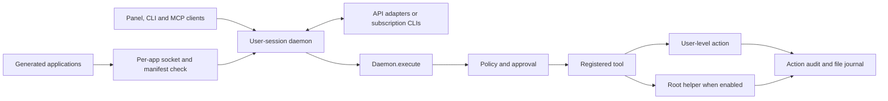

# Architecture

Amadeus combines an ordinary desktop, a user-session AI daemon, and a separate privileged
helper. [DECISIONS.md](DECISIONS.md) records why those parts were chosen; the
[README](../README.md) covers user workflows and verification limits.

## Requests and authority

`Daemon.execute` is the enforcement point for Amadeus tool calls. It resolves a tool's
capability and argument-dependent risk, applies path and capability policy, obtains any
required approval, checks whether the task was stopped, runs the tool, and records the
relevant result. The [daemon](../ai/amadeus/daemon.py) and
[policy](../ai/amadeus/policy.py) define the actual routing and decisions.

The panel keeps a session ID per task and correlates responses by request ID, allowing
parallel tasks on one connection. File-journal entries are associated with their session
so a task can undo its own recorded file changes. Stopping a task prevents further tools
and terminates its registered provider process; completed changes remain until explicitly
undone. Window actions and package changes are outside the file journal.

## Providers and defaults

There are two execution models. API adapters return model turns while the daemon owns
the tool loop. Subscription CLIs own their agent loop and reach Amadeus tools over MCP.
The [provider factory](../ai/amadeus/providers/__init__.py) defines supported adapter types;
the [configuration module](../ai/amadeus/config.py) defines shipped profiles and private
credential resolution. History uses a provider-neutral representation.

The saved panel provider lives in the AI configuration. Panel Settings and Defaults →
Agent update that value; a panel override is sent explicitly with the next request and
then returns to the saved choice. Each task displays the provider it used. This is
independent from the terminal harness preference used by the desktop wrappers.

Provider setup RPCs return display-safe fields, never saved API keys. API keys are written
to private files. Native subscription sign-in remains with the installed CLI. An installed
binary or populated model setting is a setup hint rather than a successful authentication
check. The Antigravity adapter disables native system actions and exposes the Amadeus MCP
bridge; these adapter boundaries also need testing against real provider logins.

The bar reads the saved provider without starting the daemon just to show a label. Usage
is requested on opening or explicit refresh, with a short-lived cache and bounded replies.
Collectors read vendor account limits without a model call or credential refresh. They
return quota/status fields rather than tokens. Recent request counts come from Amadeus's
audit records and do not measure all activity in external clients. See
[usage collection](../ai/amadeus/usage.py).

## Desktop state and search

The shell reads compositor events and service bindings for live state. Layout and theme
are configuration data; the available widget IDs must agree with the AI desktop tools.
The panel and generated apps share QML components with the shell's visual theme.

Each picker opening loads an index of eligible desktop entries and settings routes, then
filters locally. Apps applies desktop visibility, user-entry precedence and package-owner
filtering. Settings are searchable even when they are omitted from the ordinary Apps
list. A global result cancels the originating picker before its action is resolved and
launched, so another menu cannot interpret the result as a package or display mode.
Free-text prompts are kept distinct from list navigation.

Configuration application depends on the surface. Hyprland loads personal overrides over
shipped defaults and validates managed changes before reloading. The shell watches its
JSON files. Text size updates shell/panel sizing, GTK scale and terminal configuration;
terminals that cannot reload take the change in a new window. Explicit GPU-mode changes
require a new login because the compositor selects its rendering device at startup.

The audio picker tracks ready PipeWire endpoints and checks the complete source/sink type.
Application streams, monitors and virtual nodes are filtered from its device choices.

## Generated applications

An app has QML sources, a manifest, private data and source-version history under the
configured app-data directory. Its manifest grants access to resources such as network,
files, GPU and specific Amadeus tools. The [app framework](../ai/amadeus/apps.py) and
[sandbox builder](../ai/amadeus/sandbox.py) are the schema and enforcement sources.

An empty manifest grants a window and its own data, with no home-directory, network or
session-bus access. Widening permissions requires approval. Source changes are syntax
checked and saved transactionally before becoming versions. App source rollback does
not roll back its private runtime data.

An app's OS component connects to a dedicated socket. The daemon first limits the call
to manifest-granted tools, then applies normal system policy. State-changing app requests
require approval even when the ordinary user policy would allow them. Apps do not gain
provider-configuration or root-management RPC access through that socket.

## Security and recovery boundaries

| Risk | Treatment |
|---|---|
| Read | Subject to capability policy and path denials; no approval prompt. |
| Modify | Policy can allow, ask or deny; eligible grants may last for the session. |
| Destructive | Always asks when policy permits consideration; never remembered. |
| Privileged | Structured tools require root mode and approval for each action. |

Path denials resolve symlinks and parent traversal. The shipped policy protects credential
locations; the configuration's private secrets store is additionally protected by the
policy implementation. A denial cannot be bypassed by choosing another Amadeus client.

The daemon never runs as root. User-enabled root mode starts a transient helper through
polkit. It checks the peer user and validates its permitted operations again. Unrestricted
root execution requires the explicit full mode. Root mode expires at shutdown and can
have a shorter lifetime.

Approved host-shell commands run with the user's existing OS privileges. The separately
authenticated passwordless-sudo switch applies to user processes, including those commands;
it is not the structured root helper. Both controls are off by default.

Recovery has distinct scopes:

- File tools journal changes they can restore. Some system-file operations also make
  backups before replacement; inspect the tool result for the recovery path.
- The update command takes a snapshot before updating. Number-based cleanup keeps the
  configured recent history. Ordinary manual package operations have no automatic hook.
- The structured AI package helper attempts a pre/post snapshot pair and reports the
  resulting IDs and recovery information. Failure to create a snapshot must not be
  mistaken for a guaranteed recovery point.
- System-root rollback restores the selected btrfs root and its matching boot files.
  Home, logs and package-cache subvolumes are separate from that root snapshot.

The audit is hash-chained and redacts resolved secrets. Requests, denials, state-changing
actions and failed reads are recorded; successful read-only tools are not individually
logged as actions. Hash verification detects changes in the retained chain. Approvals
expire or close to denial by default.

These boundaries govern registered Amadeus operations. A provider login, an arbitrary
user-launched program and already granted OS privileges are separate trust decisions.

## Installation and the live medium

The guided UI collects answers and delegates installation to the same backend used by
the unattended VM harness. Base package lists are unconditional. The optional extras
answer controls a separate bundle; it never installs the optional gaming/chat clients or
coding harnesses automatically. GNOME Keyring is absent from the default package lists.
Repository signing keys and private API-key files serve separate purposes.

The ISO carries a local repository collected from the install package lists and bundled
apps. The target CPU supports the bundled x86-64-v3 packages; the generic fallback needs
network downloads. The Try session uses the live kernel and a temporary user, with
changes in memory. Portable installation is an explicit workflow for a selected USB
and includes broader driver/boot coverage.

The medium also carries package-index snapshots for offline browsing. A shared seeder
publishes only missing indexes, atomically, with a timestamp that requires their first
online refresh. It never stamps old data with installation time or overwrites an existing
cache. Pacman then downloads current database/signature pairs under its configured
verification policy. The ISO compressor does not traverse temporary mounted filesystems.

## Hardware policy

Automatic mode configures Intel rendering and per-app NVIDIA offload. An explicit GPU
preference can change that policy at the next login. The launcher and AI desktop tools
honor those choices; status reads use sysfs instead of waking the NVIDIA card to inspect it.

The selected driver packages, firmware and power settings are configuration choices, not
proof of real-machine behavior. Vulkan and video-decode paths are provisioned for the
target GPUs; CUDA is optional and applies to NVIDIA. Suspend, runtime power-down, Dynamic
Boost and the explicit GPU modes still need hardware validation.
